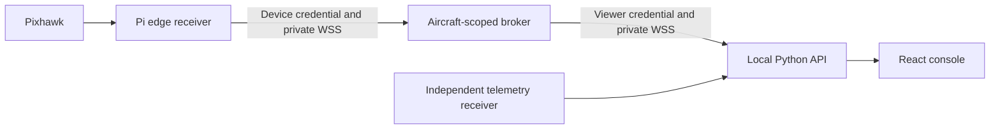

# Backend hardening and release evidence

Baseline: `58ba9ae` includes PR #19 and its independent receive-only primary and backup receivers. The first hardening change is limited to the independent broker.

| Priority | Finding and evidence | Change or remaining mitigation |
| --- | --- | --- |
| High | Broker used a stream decoder across message boundaries. An incomplete message could carry buffered bytes into the next envelope. | Decode each WebSocket message independently. Regress truncated, concatenated and prefixed packets followed by valid packets. |
| High | Each viewer had a bounded queue, while the number of viewers per aircraft and duration of a send were unbounded. | Cap viewers at 16 per aircraft and time out slow sends. Expose per-slot drop and timeout counts internally. |
| Medium | Staging Uvicorn used its default WebSocket frame and queue limits even though telemetry messages are at most 300 bytes. | Set the staging frame limit to 512 bytes and inbound queue to 16. |
| Medium | Freshness used zero timestamps without an explicit first-packet check. | Require an observed monotonic timestamp for heartbeat and attitude. |
| High, open | Static role-bound tokens can be reused until configured digests rotate. | Define a rotation and revocation drill, then evaluate short-lived, aircraft-scoped credentials. Kerberos is relevant only if an existing enterprise realm must authenticate human operators. |
| Open | Authenticated application endpoints do not establish hosted TLS, physical UART behavior or operational availability. | Use the existing private gateway and validate physical deployment separately. |

## Release checks

1. Verify the final commit in GitHub Actions. Run the API, console, broker, edge and integration jobs. Review Docker packaging separately.
2. In staging, compare direct USB and private-relay telemetry from a disarmed aircraft with propellers removed. Check heartbeat, attitude, GNSS validity and camera behavior.
3. Interrupt only the primary receive link. Check that its indicators go stale, verify the independent backup, and confirm operator-selected switching.
4. Restart edge and broker processes, rotate credentials, and check session isolation and recovery with two aircraft before a longer soak.
5. Record packet age p50/p95/p99, loss, CPU, memory and reconnect timings. A local parser benchmark does not measure deployed network latency.

## Remaining order of work

Validate private TLS and credential rotation in staging, then measure network and process fault behavior. Add persisted operational records after defining aircraft ownership, retention and migration behavior. Compare simulated and physical telemetry evidence before updating the release acceptance record.

The staging image installs the WebSocket protocol dependency explicitly. The Docker command selects that implementation so the frame and queue limits apply.

## Local parser baseline

One run validated 40,000 alternating serialized MAVLink 2 heartbeat and attitude packets in-process with a single aircraft slot. It sustained **153,029 packets/s**, with per-packet p50/p95/p99 of **4.59/6.90/44.52 µs** and zero rejected packets. These timings exclude network, TLS, fan-out and frontend rendering. Repeat with the synthetic identities and frame builders in `cloud/tests/test_cloud.py`, timing each call to `Slot.validate` with `time.perf_counter_ns`.
